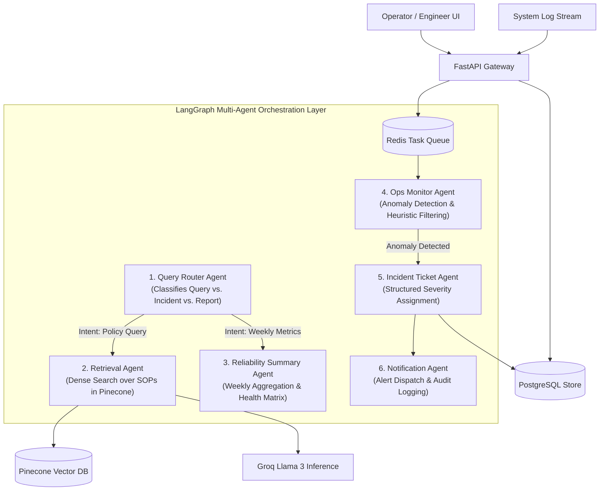

# AI Operations Copilot
### Multi-Agent SOP Retrieval, Log Anomaly Monitoring & Incident Management

[](https://fastapi.tiangolo.com/)
[](https://langchain-ai.github.io/langgraph/)
[](https://react.dev/)
[](https://www.pinecone.io/)
[](https://www.postgresql.org/)
[](https://redis.io/)
[](https://www.docker.com/)
[](LICENSE)

---

## System Overview

Internal DevOps and IT operations teams frequently face two parallel inefficiencies: fragmented access to internal Standard Operating Procedures (SOPs) buried across unstructured policy documents, and alert fatigue caused by manually correlating high-volume system logs with incident response protocols.

**AI Operations Copilot** is an enterprise multi-agent system orchestrated with **LangGraph**. It automates internal knowledge retrieval over vectorized operational documentation while continuously monitoring ingestion logs to detect anomalies, auto-generate tracked incident tickets in PostgreSQL, and synthesize weekly reliability reports.

---

## Multi-Agent Architecture



### Agent Roles

1. **Query Router Agent:** Evaluates natural language input to route execution paths between knowledge retrieval, active incident queries, and operational summaries.
2. **Retrieval Agent:** Decomposes SOP documentation (PDF / DOCX) into chunked embeddings within Pinecone and generates factual answers citing source sections.
3. **Ops Monitor Agent:** Evaluates incoming server and application log records against anomaly heuristics to detect error spikes, connection drops, and service degradations.
4. **Incident Ticket Agent:** Parses detected anomalies into structured incident tickets with severity levels (P1-P4) and writes them to PostgreSQL.
5. **Notification Agent:** Dispatches actionable notification payloads to configured communication webhooks.
6. **Weekly Summary Agent:** Compiles weekly Mean-Time-To-Acknowledge (MTTA), ticket volumes, and recurrence rates into an operational executive brief.

---

## Technical Stack

* **Backend Services:** FastAPI, Python 3.10, SQLAlchemy ORM, Pydantic data schemas.
* **Agentic Orchestration:** LangGraph state machine coordinating deterministic task dependencies.
* **Vector Indexing & RAG:** Pinecone serverless vector database paired with Groq Llama 3 inference.
* **Relational Storage & Queues:** PostgreSQL for ticket lifecycle and audit logs; Redis for background asynchronous task queuing.
* **Frontend Dashboard:** React 18, TypeScript, Vite, Tailwind CSS with real-time incident telemetry.

---

## Setup & Deployment

### 1. Repository Setup
```bash
git clone https://github.com/ahmadarif238/AI-Operations-Copilot.git
cd AI-Operations-Copilot
```

### 2. Environment Configuration
```bash
cp .env.example .env
# Configure GROQ_API_KEY, PINECONE_API_KEY, and database credentials in .env
```

### 3. Full-Stack Docker Deployment
```bash
docker-compose up --build
```
* Client Dashboard: `http://localhost:3000`
* FastAPI Swagger Documentation: `http://localhost:8000/docs`

### 4. Database Seeding & SOP Document Indexing
In a separate terminal:
```bash
# Seed database schemas and synthetic log records
python tools/seed_db.py

# Generate and index sample SOP operational documents
python tools/generate_sops.py
```

---

## Author & Academic Context

Engineered by **Arif Ahmad Khan** as an implementation of multi-agent state machines applied to internal DevOps reliability engineering and automated log intelligence.

Released under the [MIT License](LICENSE).
