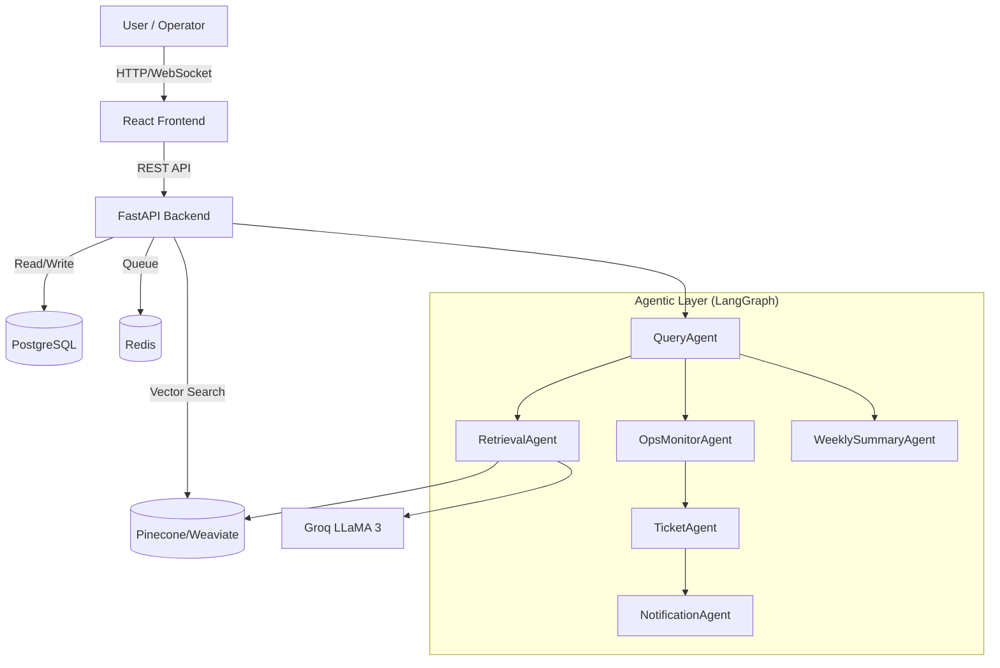

# AI Operations Copilot - Architecture

## Overview
The AI Operations Copilot is an internal tool designed to assist operations teams by automating SOP retrieval, monitoring logs for incidents, and managing ticketing workflows. It utilizes a multi-agent architecture orchestrated by **LangGraph** to handle complex decision-making processes.

## High-Level Architecture

## Components

### 1. Frontend
- **Stack**: React, TypeScript, Vite, TailwindCSS.
- **Pages**:
    - **Dashboard**: Real-time stats on tickets, logs, and system health.
    - **Chat**: Conversational interface for querying SOPs and reporting issues.
    - **Docs Upload**: Drag-and-drop interface for indexing new policy documents.

### 2. Backend
- **Stack**: Python 3.10, FastAPI.
- **Role**: API Gateway, Data Management, Agent Orchestration.
- **Modules**:
    - `app.core`: Config and Logging.
    - `app.api`: REST Endpoints (`/ask`, `/log`, etc.).
    - `app.db`: SQLAlchemy models for relational data.
    - `app.rag`: Indexing and Retrieval logic.
    - `app.agents`: LangGraph workflow definitions.

### 3. Database
- **PostgreSQL**: Stores robust relational data:
    - `Users`: Auth and roles.
    - `Logs`: Incoming system logs.
    - `Tickets`: Incident tickets with status/severity.
    - `Documents`: Metadata for uploaded SOPs.
- **Redis**: Used for background task queues (RQ/Celery) and caching.

### 4. Vector Store (RAG)
- **Primary**: Pinecone (for production scale).
- **Fallback**: Local mock or Weaviate/Chroma for offline/testing.
- **Pipeline**: Docs -> Text Splitter -> Embeddings (Groq/OpenAI) -> Vector DB.

### 5. Agents (LangGraph)
- **QueryAgent**: Classifies intent (Question vs. Incident vs. Report).
- **RetrievalAgent**: Fetches context from Vector DB and synthesizes answers.
- **OpsMonitorAgent**: Analyzes logs for anomalies (Rules + ML heuristics).
- **TicketAgent**: Auto-creates tickets in Postgres and external tools.
- **NotificationAgent**: Dispatches alerts via Slack/WhatsApp/Email.
- **WeeklySummaryAgent**: Aggregates weekly data into a report.

## Data Flow
1. **User Query**: User asks "How to request leave?" -> Router -> RetrievalAgent -> Answer with Citations.
2. **Log Ingestion**: System POSTs log -> Backend -> Background Task -> OpsMonitorAgent -> (If Critical) -> TicketAgent -> NotificationAgent -> Slack Alert.
